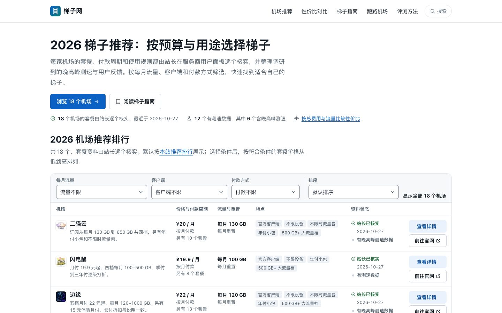
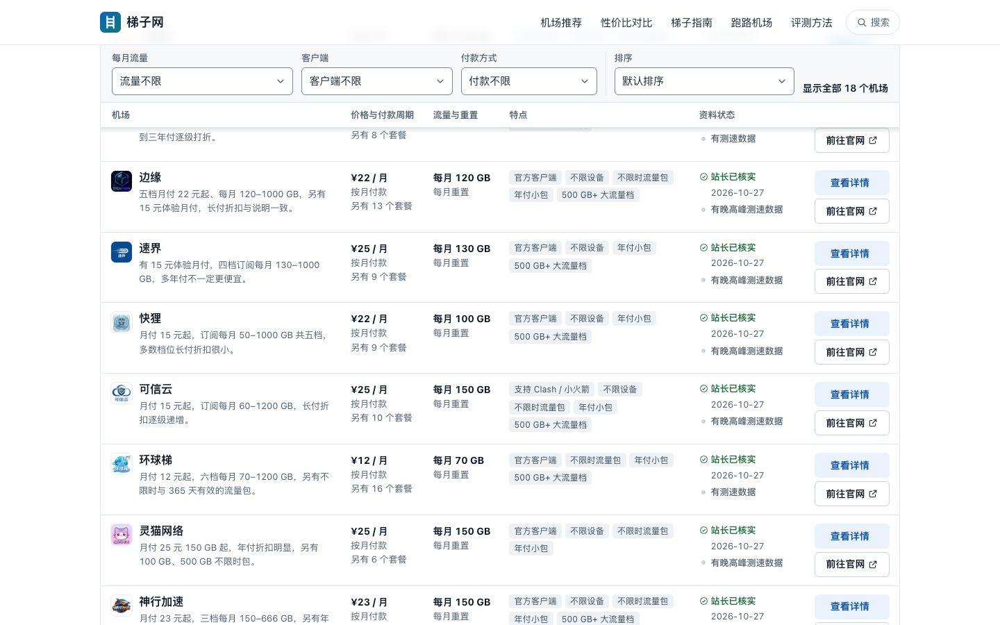
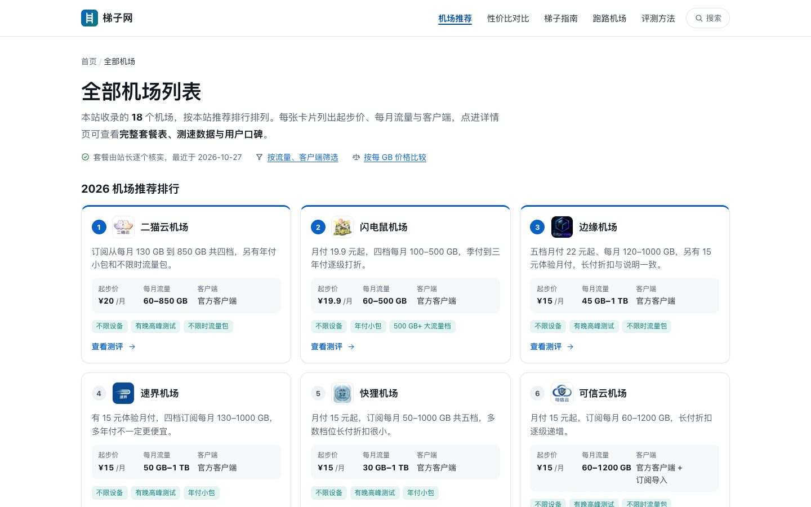
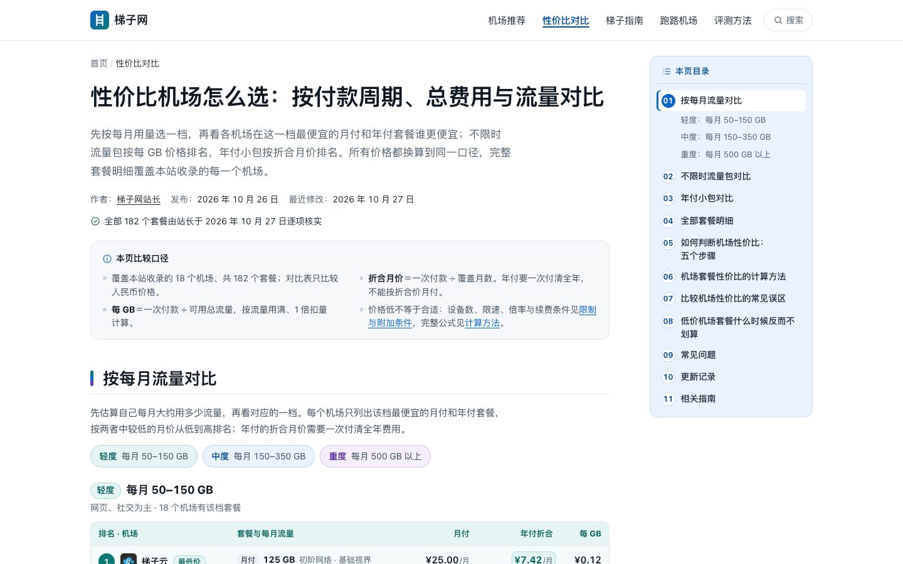
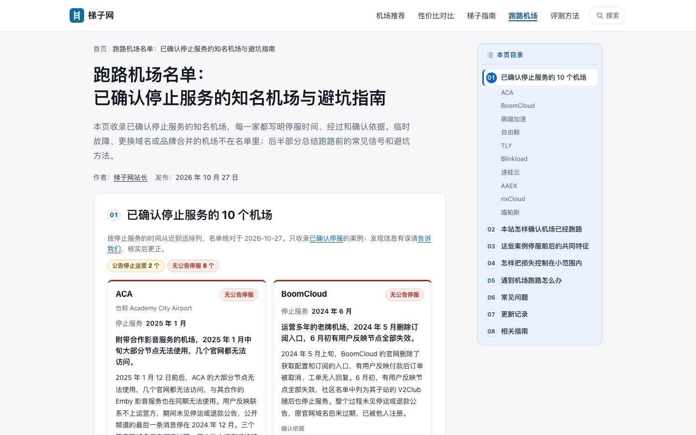
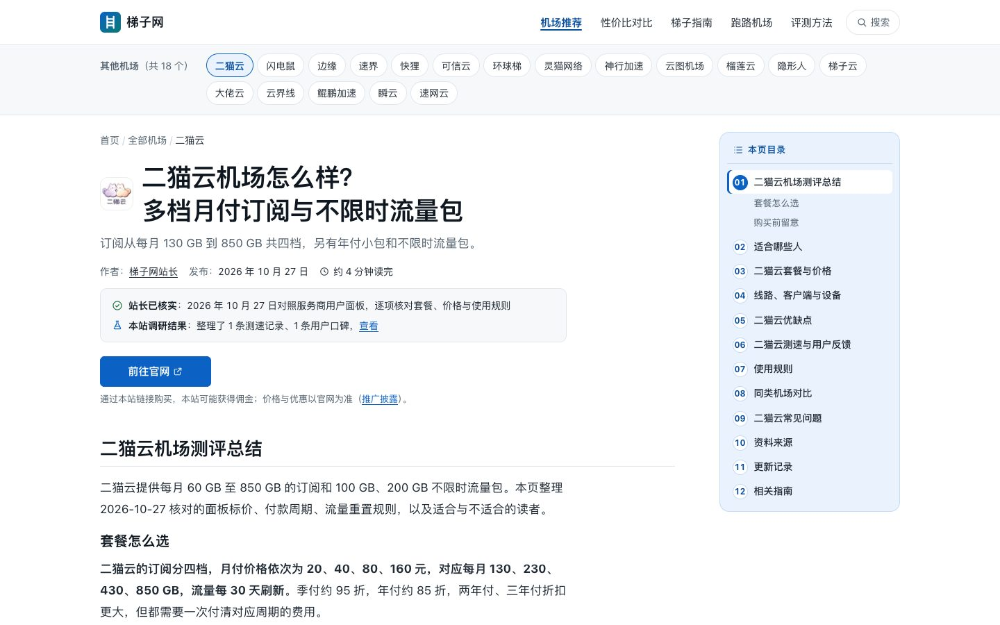
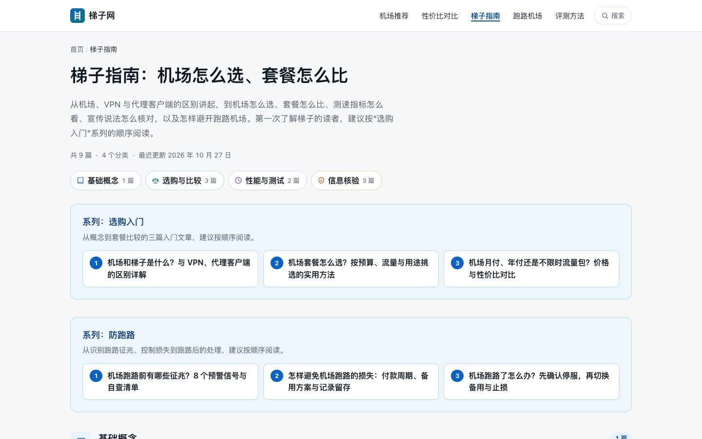
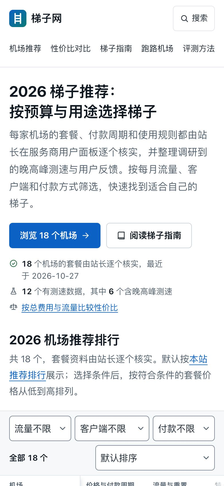

# 梯子网 · tiziwang.blog

**机场推荐、梯子选购与网络知识**

[访问网站](https://tiziwang.blog/) · [梯子推荐排行](https://tiziwang.blog/#airports) · [全部机场](https://tiziwang.blog/airports/) · [性价比对比](https://tiziwang.blog/best-value/) · [跑路机场](https://tiziwang.blog/paolu/) · [梯子指南](https://tiziwang.blog/guides/)

---

梯子网整理机场（代理订阅服务）的套餐价格、付款周期、流量规则和使用限制，把不同付款方式换算到同一口径比较，并提供选购与避坑方法。

> *Tiziwang is a Chinese-language guide to proxy subscription services ("airports"): verified plan prices, side-by-side comparisons, a list of confirmed shutdowns, and buying guides. This repository only contains an introduction and screenshots — the website's source code is not published.*

## 网站有什么

| 栏目 | 内容 |
| --- | --- |
| [梯子推荐排行](https://tiziwang.blog/#airports) | 全部机场一张表看完：价格与付款周期、每月流量、客户端、特点；可以按流量、客户端、付款方式筛选和排序 |
| [全部机场列表](https://tiziwang.blog/airports/) | 每个机场一张卡片：起步价、每月流量、客户端，点进去看完整测评 |
| [性价比对比](https://tiziwang.blog/best-value/) | 按每月用量分轻度、中度、重度三档，比较各家最便宜的月付与年付；另有不限时流量包、年付小包排行 |
| [跑路机场名单](https://tiziwang.blog/paolu/) | 已确认停止服务的知名机场：停服时间、经过与确认依据，以及跑路前的常见信号 |
| [梯子指南](https://tiziwang.blog/guides/) | 选购入门、价格换算、测速方法、防跑路系列等文章 |
| [评测方法](https://tiziwang.blog/methodology/) | 推荐排行怎么排、资料怎样核验、价格怎样换算 |

## 网站特点

- **价格逐个核实**：每个机场的套餐由站长在服务商官网或用户面板核对，写明核实日期。
- **同一口径比较**：月付、季付、年付、流量包统一换算成折合月价和每 GB 价格，并注明需要一次付清的金额。
- **跑路名单只收已确认的案例**：只收录官方公告停运，或长期无法访问且多方用户反映的机场；临时故障、换域名、品牌合并的不收录。
- **写明推广关系**：“前往官网”是推广链接，规则见[推广披露](https://tiziwang.blog/disclosure/)；推广关系不影响资料核验与价格换算。
- **轻量、无追踪**：纯静态网站，不加载第三方统计脚本，手机上打开也很快。

## 截图

**梯子推荐排行**：往下翻时筛选栏和表头固定在顶部，随时可以改条件。

**全部机场列表**

**性价比对比**：按每月用量分档排名。

**跑路机场名单**

**机场测评详情**

**梯子指南**

**手机版**

## 热门机场测评

| 机场 | 测评 |
| --- | --- |
| 二猫云 | [二猫云机场怎么样](https://tiziwang.blog/airports/ermaoyun/) |
| 闪电鼠 | [闪电鼠机场怎么样](https://tiziwang.blog/airports/shandianshu/) |
| 边缘 | [边缘机场怎么样](https://tiziwang.blog/airports/bianyuan/) |
| 速界 | [速界机场怎么样](https://tiziwang.blog/airports/sujie/) |
| 快狸 | [快狸机场怎么样](https://tiziwang.blog/airports/kuaili/) |
| 可信云 | [可信云机场怎么样](https://tiziwang.blog/airports/kexinyun/) |

更多机场见[全部机场列表](https://tiziwang.blog/airports/)。

## 推荐阅读

**选购入门**

- [机场和梯子是什么？与 VPN、代理客户端的区别详解](https://tiziwang.blog/guides/airport-vpn-proxy-basics/)
- [机场套餐怎么选？按预算、流量与用途挑选的实用方法](https://tiziwang.blog/guides/choose-plan-by-budget-and-usage/)
- [机场月付、年付还是不限时流量包？价格与性价比对比](https://tiziwang.blog/guides/billing-cycles-compared/)

**防跑路**

- [机场跑路前有哪些征兆？8 个预警信号与自查清单](https://tiziwang.blog/guides/airport-runaway-warning-signs/)
- [怎样避免机场跑路的损失：付款周期、备用方案与记录留存](https://tiziwang.blog/guides/avoid-airport-runaway-losses/)
- [机场跑路了怎么办？先确认停服，再切换备用与止损](https://tiziwang.blog/guides/after-airport-runaway/)

**测速与核对**

- [机场测速指标详解：延迟、抖动、丢包与晚高峰变慢](https://tiziwang.blog/guides/performance-metrics-explained/)
- [机场节点测速方法：可复核的测试条件、统计与记录模板](https://tiziwang.blog/guides/reproducible-test-records/)
- [机场避坑指南：宣传页、测速截图与推荐榜核对清单](https://tiziwang.blog/guides/verify-claims-and-reviews/)

## 联系

内容勘误、资料更新与合作咨询：Telegram [@xiaoyu33s](https://t.me/xiaoyu33s)，或见网站[联系页面](https://tiziwang.blog/contact/)。

## 说明

- 本仓库只包含网站介绍与截图，**不包含网站源代码**。
- 网站内容与截图版权归梯子网所有，未经许可请勿转载或商用，详见 [LICENSE](LICENSE)。
- 请遵守所在地的法律法规与服务条款。
